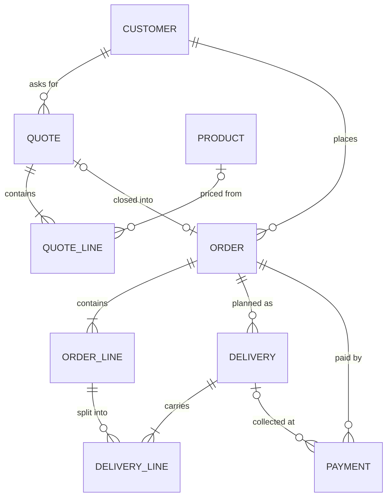

# Inauviet ERP — Technical Spec (v0.8)

**Backend:** Node.js 22 LTS · NestJS · Prisma 7 · PostgreSQL
**Frontend:** React 19 · TypeScript · Vite · Ant Design 6
**Repository:** `Inauviet/ERP/` with `api/` and `web/` (npm workspaces), next to `Inauviet/CMS/`
**Scope:** A simple order and delivery tracker. Staff create orders with a delivery plan, follow every order on a board, mark deliveries done, and optionally record payments.
**Status:** Codebase initialized 29 Oct 2026 (milestones M0–M3 built and tested, M4 deployment files in place). Open questions are in section 12.

**Changes in v0.8 (separate modules and the accounting module, 05 Nov 2026)**
- After sign-in a module picker (`/`) shows only the modules the account may use: **CRM**, **Kế toán**, **Quản trị**. Each module has its own sidebar menu and a switcher at the top of the menu (also "Chọn module" in the user menu). CRM paths are unchanged; accounting lives under `/accounting/*` plus `/payments`.
- Accounting module (internal books, Thông tư 133, no e-invoice): periods by month with month-end steps and closing, cash/bank book with expense vouchers, receivables/payables, raw-material stock at the monthly weighted average, fixed assets and tools, VAT 8%, general journal and trial balance, P&L and general ledger. See section 13.
- Order lines can no longer change once the customer has signed acceptance (`ORDER_COMPLETED`), since revenue is booked from them.

**Changes in v0.7 (steps 2–6 of the 6-step process, as in the prototype)**
- Order statuses follow the steps: CONFIRMED (2 · Chốt đơn) → DESIGNING (3 · Thiết kế) → DESIGN_FINALIZING (4 · Hoàn thiện TK) → IN_PRODUCTION (5 · Sản xuất) → DELIVERING (6 · Giao hàng) → COMPLETED. "Bắt đầu sản xuất" is replaced by "Xác nhận đơn" (needs design, or customer files go straight to production).
- Design: designer, maket versions v1, v2… with the customer's answer, approval (version, channel, approver), "print files finished", lock → work order. "Khách đổi ý" sends an approved order back to step 3.
- Production: work order LSX-YYMM-NNNN with stages Nhận lệnh → In → Gia công → Kiểm tra → Xong, due date and priority, then "Chuyển giao hàng".
- Delivery no longer completes the order on its own: when everything is delivered, the signed acceptance report (biên bản nghiệm thu) completes it. Trips of an accepted order cannot be reopened.
- New pages: Thiết kế, Sản xuất, Thanh toán & công nợ (under Kế toán), acceptance tabs on Giao hàng, 6-column board with open quotes and KPIs.
- Documents are real PDF files generated on the server (pdfmake, Roboto font, temporary A4 layout): quote, order, design approval, work order, acceptance report, internal invoice. Download icons in every list (one file, or a menu with each file and "Tải cả bộ" as .zip), "In / tải tài liệu" on the order page, and on the customer page every quote/order with its files, filter by document type, and one zip of everything (a folder per order). Shop details printed in the header come from `COMPANY_*` in `.env`.
- New permissions design.view/assign/work, production.view/update, deliveries.accept; new starting groups "Thiết kế" and "Sản xuất" (no prices).
- Migration `20261031090000_design_production_acceptance`: existing orders count as confirmed; orders already in production get needsDesign = false; completed orders get acceptedAt = completedAt.

**Changes in v0.6 (ERP, phase 1 of the 6-step process)**
- Project renamed CRM → ERP (folder, packages, database `erp`, cookie `erp_session`). The CRM part follows the prototype first; the accounting module comes later.
- Step 1: product catalog (Sản phẩm) priced per m² (width × height) or per unit, and quotes BG-YYMM-NNNN with statuses Nháp / Đã gửi / Đã chốt / Khách không lấy.
- Step 2: closing a quote creates the order with the same lines. Products, sizes and quantities can be changed on the order without approval; each change is logged and the order shows what differs from the quote.
- Migration `20261030120000_products_quotes`; groups that create orders and see prices get the quote permissions.

**Changes in v0.5 (accounts and permissions)**
- Sign-in with username + password (scrypt hashes), server-side sessions in an HttpOnly cookie. Cloudflare Access is now only an optional outer layer.
- Accounts are created by hand (Tài khoản); permission groups (Nhóm quyền) hold permissions per module × action. Replaces the fixed OWNER/STAFF roles.
- Migration `20261029160000_accounts_permissions` moves existing OWNER accounts to "Quản trị viên" and STAFF to "Nhân viên".

**Changes in v0.4 (as built)**
- Login through Cloudflare Access; the app stores staff and roles only (no passwords, no sessions table). See section 7.
- Order gained `productionStartedAt` and `cancelledAt`; ActivityLog gained `orderId` so an order's history includes its trips and payments.
- Pinned to stable majors: NestJS 11, TypeScript 5.9, Jest 29, React Router 7, Vite 7, jose 5 (CommonJS-compatible).
- The schema in section 5 is now a summary; `api/prisma/schema.prisma` is the source of truth.

**Changes in v0.3 (simplified scope)**
- App reduced to 6 pages: order board, orders, order detail, deliveries, customers, users.
- Deliveries are planned when the order is created (one or more trips, each with dates and quantities per line).
- Short deliveries: undelivered quantity goes back to "not yet planned".
- Prices and payments are optional. A payment always belongs to an order and can optionally point to the delivery it was collected on.
- Order status is driven by deliveries only. Payment never blocks or closes an order. Deposit gate removed.
- Removed from v1: quotes, design/maket approval, work orders, file uploads, PDFs, live updates (Socket.IO), notifications, background jobs, workshop phone app. These are listed in section 11 as later phases.

---

## 1. Decisions so far

| # | Decision | Date |
|---|---|---|
| D1 | One repository for `api/` and `web/` | 29 Oct 2026 |
| D2 | NestJS + Prisma + PostgreSQL backend; React + Ant Design frontend | 29 Oct 2026 |
| D3 | Simplified app: board + order/delivery status handling only | 29 Oct 2026 |
| D4 | No realtime: pages refresh on open, on returning to the tab, and with a refresh button | 29 Oct 2026 |
| D5 | Delivery plan entered at order creation | 29 Oct 2026 |
| D6 | Payments optional; linked to the order, optionally to a delivery | 29 Oct 2026 |
| D7 | Short delivery returns the missing quantity to "not yet planned" | 29 Oct 2026 |
| D8 | ~~Login with Cloudflare Access~~ replaced by D10 | 29 Oct 2026 |
| D9 | Project name `ERP` (renamed from `CRM` on 30 Oct 2026), in `D:\Source.Code\Inauviet\ERP` | 30 Oct 2026 |
| D10 | Username + password accounts created by hand; permissions through groups (module × action) | 29 Oct 2026 |

---

## 2. Worked example

Công ty ABC orders on 27/10. Order **DH-2610-0042**:

| Line | Quantity | Unit price (optional) |
|---|---|---|
| Banner hiflex 2×1 m | 10 | 500.000 đ |
| Decal PP 30×40 cm | 200 | 35.000 đ |

Total 12.000.000 đ. Delivery plan entered with the order:

| Delivery | Planned date | Banner | Decal |
|---|---|---|---|
| GH-2610-0011 | 02/11 | 10 | 100 |
| GH-2610-0012 | 04/11 | — | 100 |

What happens next:

| Date | Action | Order status | Payment |
|---|---|---|---|
| 27/10 | Order created, 2 trips scheduled | Confirmed | Deposit 3.000.000 đ (order only) |
| 28/10 | Staff clicks "Start production" | In production | |
| 02/11 | GH-2610-0011 marked delivered (10 banners, 100 decals) | Delivering | 5.500.000 đ collected, linked to GH-2610-0011 |
| 04/11 | GH-2610-0012 marked delivered (100 decals) | Completed | 3.500.000 đ collected, linked to GH-2610-0012 |

Balance at the end: 12.000.000 − 12.000.000 = 0 đ.

**Short delivery variant:** on 04/11 only 80 decals go out. GH-2610-0012 is saved with planned 100, delivered 80. The order stays **Delivering** and shows "20 decals not yet planned". Staff adds them to a new trip (GH-2611-0003); when that is delivered, the order becomes **Completed**.

---

## 3. Tech choices

### Backend

| Concern | Choice | License |
|---|---|---|
| Runtime | Node.js 22 LTS | MIT |
| Framework | NestJS 11 | MIT |
| ORM / migrations | Prisma 7 (pin 7.10.x) + `@prisma/adapter-pg`. Prisma 8 is still a release candidate | Apache 2.0 |
| Database | PostgreSQL 16+ with `pg_trgm` for search | PostgreSQL |
| Validation | class-validator + class-transformer | MIT |
| API docs | @nestjs/swagger → `openapi.json` + Swagger UI at `/api/docs` | MIT |
| Auth | Username + password; Node `crypto.scrypt` hashes; server-side sessions (random token in HttpOnly cookie, SHA-256 in DB) | built-in |
| Logging | nestjs-pino | MIT |
| Config | @nestjs/config + zod | MIT |
| Tests | Jest + Supertest | MIT |

### Frontend

| Concern | Choice | License |
|---|---|---|
| UI | React 19 + TypeScript | MIT |
| Build | Vite 7 | MIT |
| Components | Ant Design 6 (`vi_VN` locale) + @ant-design/icons | MIT |
| Routing | React Router 7 | MIT |
| Server state | TanStack Query 5 (refetch on window focus, no polling) | MIT |
| API client | openapi-typescript + openapi-fetch, generated from the API | MIT |
| Dates | dayjs (`vi` locale) | MIT |
| Language | Vietnamese only; API error codes mapped in `web/src/lib/errors.ts` | — |
| Tests | Vitest + Testing Library; Playwright end-to-end | MIT / Apache 2.0 |

Not needed in v1: Socket.IO, pg-boss, S3/MinIO, PDF library.

---

## 4. Project structure

See the structure section of `README.md`. Key files:

| File | What it holds |
|---|---|
| `api/prisma/schema.prisma` | Data model (source of truth) |
| `api/src/orders/order-calc.ts` | Every quantity, total and status rule, as one pure function with unit tests |
| `api/src/orders/order-recalc.service.ts` | Runs that function at the end of every write, in the same transaction |
| `api/src/access/permissions.ts` | The permission catalog (module × action), implied permissions, default groups |
| `api/src/auth/auth.guard.ts` | Session check, forced password change, `@RequirePermission` enforcement (fail-closed) |
| `api/src/auth/money.interceptor.ts` | Removes every `*Vnd` field for accounts without `money.view` |
| `api/openapi.json` | API contract, generated from code |
| `web/src/api/schema.d.ts` | Frontend types, generated from `openapi.json` |

## 5. Data model



Source of truth: `api/prisma/schema.prisma`; first migration: `api/prisma/migrations/20261029140000_init`.

| Table | Notes |
|---|---|
| User | username (unique, lowercase), passwordHash (scrypt), mustChangePassword, fullName, optional email/phone, roleId, isActive, lastSeenAt |
| Role | Permission group: name, description, permissions `text[]` of keys like `orders.create`, isSystem (built-in admin, all permissions) |
| Session | tokenHash (SHA-256 of the cookie token), expiresAt (sliding), lastUsedAt, revokedAt, ip, userAgent |
| Customer | code KH-0001, phone unique (normalized 0xxxxxxxxx), `searchText` without diacritics, GIN trigram index |
| Product | name (unique), category, pricingMode AREA (per m²) / UNIT, unit, unitPriceVnd (list price), isActive |
| Quote | code BG-YYMM-NNNN, customerId, title, status DRAFT/SENT/WON/LOST, quoteDate, validDays, note, totalVnd, sentAt, lostAt + lostReason, wonAt |
| QuoteLine | productId?, description, spec, unit, widthM/heightM (AREA), areaPriceVnd (per m²), quantity, unitPriceVnd (one piece = round(w × h × price per m²)), lineTotalVnd |
| Order | code DH-YYMM-NNNN, quoteId (unique, optional), status, orderDate, dueDate, cached totalVnd / paidVnd, productionStartedAt, completedAt, cancelledAt |
| OrderLine | quantity, cached plannedQty / deliveredQty, optional unitPriceVnd, lineTotalVnd; productId, quoteLineId, unit, widthM/heightM, areaPriceVnd for lines from the catalog |
| Delivery | code GH-YYMM-NNNN, status SCHEDULED/DELIVERED/CANCELLED, plannedDate, deliveredAt, address, receiverName |
| DeliveryLine | plannedQty, deliveredQty (set when delivered) |
| Payment | orderId required, deliveryId optional, amountVnd > 0, voidedAt / voidReason instead of delete |
| DocumentSequence | atomic counters for document codes |
| ActivityLog | orderId, entityType, entityId, action, from/to, data, userId |

Conventions: UUID ids; money as whole đồng in `BIGINT`, sent as JSON numbers; calendar dates in `DATE` columns, sent as `YYYY-MM-DD`; nothing business-related is hard-deleted.

## 6. Business rules

### 6.1 Order status

| From | To | How | Who |
|---|---|---|---|
Status is derived (order-calc.ts) from the step data; the furthest step reached wins.

| From | To | How | Who |
|---|---|---|---|
| — | CONFIRMED | Order created (closing a quote or directly) | quotes.close / orders.create |
| CONFIRMED | DESIGNING | "Xác nhận đơn", needs design | orders.update |
| CONFIRMED | IN_PRODUCTION | "Xác nhận đơn", customer has print-ready files: work order created | orders.update |
| DESIGNING | DESIGN_FINALIZING | Customer approves the latest maket version | design.work |
| DESIGN_FINALIZING | DESIGNING | "Khách đổi ý" (reason required) | design.work |
| DESIGN_FINALIZING | IN_PRODUCTION | Lock design (print files marked finished): work order created | design.work |
| IN_PRODUCTION | DELIVERING | Workshop hands over (stage Xong), or **automatic** when a trip is delivered | production.update / system |
| DELIVERING | COMPLETED | Acceptance report signed; needs every line fully delivered | deliveries.accept |
| any open | CANCELLED | `cancelReason` required; scheduled deliveries are cancelled too | orders.cancel |

Payments never change order status. After acceptance, trips can no longer be reopened (`ORDER_ACCEPTED`).

### 6.2 Order lines and editing

1. An order needs at least one line with `quantity ≥ 1`.
2. A line's quantity can be changed later but never below its `plannedQty`. To reduce it further, first reduce or cancel the planned trips.
3. A line can be removed only if it has no delivery lines.
4. Prices are optional per line. `lineTotalVnd = quantity × unitPriceVnd`. `Order.totalVnd` is the sum of priced lines, or `null` if no line has a price.

### 6.3 Deliveries

1. **Plan at creation.** `POST /orders` accepts a `deliveries` array. Each trip has `plannedDate`, optional `address`, and `lines[]` of `{ orderLineIndex, plannedQty }`. Trips can also be added, edited or cancelled later.
2. **No over-planning.** For each order line, the sum of `plannedQty` on SCHEDULED trips plus `deliveredQty` on DELIVERED trips must be ≤ `quantity`.
3. **Not yet planned.** `quantity − OrderLine.plannedQty`. Shown on the order and on the board card when > 0. Not an error: an order can be created with no plan at all.
4. **Mark delivered.** Each line's `deliveredQty` defaults to `plannedQty` and can be lowered, never raised above it. Sets `deliveredAt`, optional `receiverName`.
5. **Short delivery.** If `deliveredQty < plannedQty`, the difference becomes "not yet planned" again. Nothing else changes automatically; staff add it to another trip.
6. **Reopen.** Accounts with `deliveries.reopen` can reopen a DELIVERED trip back to SCHEDULED (with a reason) to fix a mistake. Cached quantities and order status are recalculated.
7. **Cancel.** Only SCHEDULED trips can be cancelled (reason required). Their planned quantity returns to "not yet planned".
8. **Editing.** SCHEDULED trips can be edited freely within rule 2. DELIVERED trips are read-only except via reopen.
9. All cached fields (`OrderLine.plannedQty`, `OrderLine.deliveredQty`, `Order.status`) are recalculated in the same database transaction as the change.

### 6.4 Payments

1. Optional. An order with no prices can still have payments, and an order with prices can have none.
2. `orderId` is required. `deliveryId` is optional and must belong to the same order.
3. `amountVnd > 0`. Refunds are not in v1 (open question).
4. Payments are voided with a reason, never deleted. `Order.paidVnd` is recalculated in the same transaction.
5. Balance = `totalVnd − paidVnd`, shown only when `totalVnd` is set.
6. Delivery value (for display) = Σ `deliveredQty × unitPriceVnd` over its lines, ignoring unpriced lines.
7. Payment badge on orders: **Unpaid** (paid = 0), **Partly paid** (0 < paid < total), **Paid** (paid ≥ total), nothing when total is null.

### 6.5 Document codes

`PREFIX-YYMM-NNNN`, restarting each month: `DH-2610-0042` (order), `GH-2610-0011` (delivery). Customers: `KH-0001`. Generated inside the transaction with `UPDATE … RETURNING` on `DocumentSequence`, so concurrent saves never collide.

### 6.6 Activity log

One row for every order status change, delivery planned / delivered / reopened / cancelled, and payment recorded / voided. Shown as a timeline on the order detail page.

---

## 7. Accounts, sign-in and permissions

**Sign-in.** Username + password. Passwords are hashed with scrypt (N=16384, r=8, p=1, 16-byte salt). A successful login creates a
`Session` row and sets the cookie `crm_session` (HttpOnly, SameSite=Lax, Secure in production) holding a random 32-byte token;
only its SHA-256 is stored. Sessions last `SESSION_DAYS` (30) and extend on use. Logout, locking an account and password resets
revoke sessions immediately.

**Protection.** 5 wrong passwords for one username (or 30 failures from one IP) within 15 minutes → `429 LOGIN_LOCKED` for 15 minutes.
A missing username takes as long as a wrong password and returns the same error. Passwords: ≥ 8 characters, not containing the username.

**Accounts (Tài khoản).** Created by hand with username, full name, group and either a typed password or a generated temporary one
(shown once). New and reset accounts must change the password at next sign-in (`403 PASSWORD_CHANGE_REQUIRED` until then).
Rules: at least one active administrator with a password must remain; nobody can lock themselves or change their own group;
only administrators can grant the administrator group or touch administrator accounts.

**Permission groups (Nhóm quyền).** Each group holds permission keys `module.action`:

| Module | Actions |
|---|---|
| orders | view, create, update, cancel |
| deliveries | view, create, update, deliver, cancel, reopen |
| payments | view, create, void |
| money | view (without it, every `*Vnd` field and `paymentStatus` is removed from API responses) |
| customers | view, create, update |
| accounts | view, create, update, resetPassword |
| roles | view, manage |

Saving a group adds implied permissions (e.g. `payments.create` → `payments.view` → `orders.view`, `money.view`). The built-in group
"Quản trị viên" (`isSystem`) always has every permission and cannot be edited or deleted. A non-admin with `roles.manage` cannot edit
their own group. Groups in use cannot be deleted. Seed creates sample groups *Kinh doanh*, *Kế toán*, *Giao hàng*.

**Enforcement.** Every route declares `@RequirePermission(...)` or `@SignedIn()`; a route with neither is refused (fail-closed).
Rules inside actions: a deposit on a new order or money collected at delivery also needs `payments.create`; entering prices needs
`money.view`; editing lines without `money.view` keeps stored prices; order detail lists payments only with `payments.view`.

**Emergency access.** `npm run user:reset-admin -- <username>` (on the server) makes the account an active administrator with a new
temporary password.

## 8. API endpoints

Base path `/api/v1`. Lists accept `?page`, `?pageSize`, `?q`. Full contract: `api/openapi.json`, Swagger UI at `/api/v1/docs` in development.

### Sign-in, accounts, permission groups
| Method | Path | Permission | Notes |
|---|---|---|---|
| GET | /health | public | for Docker and uptime monitors |
| POST | /auth/login | public | sets the session cookie; returns account + permission keys |
| POST | /auth/logout | signed in | |
| GET | /auth/me | signed in | account, group, permission keys, mustChangePassword |
| POST | /auth/change-password | signed in | signs out other sessions |
| GET | /permissions | signed in | catalog of modules and actions with Vietnamese labels |
| GET | /accounts | accounts.view | |
| POST | /accounts | accounts.create | returns `temporaryPassword` once when generated |
| PATCH | /accounts/:id | accounts.update | details, group, `isActive` (lock/unlock) |
| POST | /accounts/:id/reset-password | accounts.resetPassword | new or generated password, signs the account out |
| POST | /accounts/:id/sign-out | accounts.update | end every session |
| GET | /roles | roles.view | groups with permissions and account count |
| POST / PATCH / DELETE | /roles[/:id] | roles.manage | |

### Customers
| Method | Path | Notes |
|---|---|---|
| GET | /customers | diacritic-insensitive `?q` |
| GET | /customers/lookup/:phone | exact match, 404 when none |
| POST | /customers | `409 PHONE_EXISTS` with the existing customer |
| GET / PATCH | /customers/:id | |
| GET | /orders?customerId= | order history (customer profile also returns counts and balance) |

### Orders
| Method | Path | Notes |
|---|---|---|
| GET | /orders | `?status`, `?customerId`, `?dueBefore`, `?hasUnplanned=true` |
| POST | /orders | customer, lines, optional `deliveries[]` plan |
| GET | /orders/:id | lines with planned / delivered / not-yet-planned qty, deliveries, payments, balance |
| GET | /orders/by-code/:code | find by DH- code |
| PATCH | /orders/:id | dates, note |
| PUT | /orders/:id/lines | replace lines (rules 6.2) |
| POST | /orders/:id/confirm | `needsDesign` (step 2) |
| POST | /orders/:id/cancel | `cancelReason` |
| GET | /orders/:id/activity | timeline |
| GET | /board | open quotes (quotes.view) + orders grouped by status with card fields; completed limited to last 14 days |

### Design, production, acceptance
| Method | Path | Notes |
|---|---|---|
| GET | /design-queue | `?mine=true`; state TODO / WAITING / CHANGES / FINAL |
| GET | /designers | active accounts with design.work |
| PATCH | /orders/:id/design | `designerId` (design.assign) |
| POST | /orders/:id/design/versions | `note?` — next version; refused while the last one waits for feedback |
| POST | /orders/:id/design/versions/:vid/feedback | `approved`, `note?`, `channel?`, `approvedByName?` |
| PATCH | /orders/:id/design/approval | `channel?`, `approvedByName?`, `finalized?` |
| POST | /orders/:id/design/unapprove | `reason` |
| POST | /orders/:id/design/lock | needs `finalized`; creates the work order |
| GET | /production | work orders in the workshop (no prices) |
| PATCH | /orders/:id/production | `dueDate?`, `priority?` (NORMAL / URGENT), `note?` |
| POST | /orders/:id/production/advance | `stage?` — next stage by default |
| POST | /orders/:id/production/handover | stage must be DONE |
| POST | /orders/:id/accept | `signedBy`, `note?` — every line fully delivered (deliveries.accept) |

### Documents (PDF)
| Method | Path | Notes |
|---|---|---|
| GET | /documents/:kind/:id | kind = quote (quote id) · order · design · lsx · acceptance · invoice (order id). Inline; `?download=true` saves the file. `DOCUMENT_NOT_AVAILABLE` before the step exists; priced kinds need money.view |
| GET | /orders/:id/documents/zip | `?kinds=order,invoice…` (default all available), includes the quote |
| GET | /customers/:id/documents | quotes and orders of the customer with their files |
| GET | /customers/:id/documents/zip | `?kinds=…`, one folder per order / quote |

### Deliveries
| Method | Path | Notes |
|---|---|---|
| GET | /deliveries | `?status`, `?from`, `?to`, `?overdue=true` (scheduled before today), `?q` |
| GET | /deliveries/:id | |
| POST | /orders/:id/deliveries | add a trip to an existing order |
| PATCH | /deliveries/:id | SCHEDULED only: date, address, line quantities |
| POST | /deliveries/:id/deliver | body: `lines[{ orderLineId, deliveredQty }]`, `deliveredAt`, `receiverName?`, optional `payment { amountVnd, method }` recorded in the same transaction |
| POST | /deliveries/:id/reopen | deliveries.reopen, `reason` |
| POST | /deliveries/:id/cancel | `cancelReason` |

### Payments
| Method | Path | Notes |
|---|---|---|
| GET | /payments | receipts across orders: `?from`, `?to`, `?method`, `?q`, `?includeVoided`; returns `sumVnd` |
| GET | /receivables | orders still owing money, delivered first; delivered / upcoming balance, deposits held |
| GET | /orders/:id/payments | |
| POST | /orders/:id/payments | `amountVnd`, `method`, `paidOn`, `isDeposit?`, `deliveryId?` |
| POST | /payments/:id/void | payments.void, `reason` |

### Errors

```json
{
  "statusCode": 409,
  "code": "PLANNED_QTY_EXCEEDS_ORDER",
  "message": "Decal PP 30×40 cm: planned 220, ordered 200.",
  "details": { "orderLineId": "…", "planned": 220, "ordered": 200 }
}
```

Stable `code` values, translated to Vietnamese in the web app.

---

## 9. Web app

### 9.1 Pages

| Route | Page | What it does |
|---|---|---|
| `/login` | Login | |
| `/board` (home) | Bảng điều phối | KPIs, then one column per step: 1 Báo giá (open quotes), 2 Chốt đơn, 3 Thiết kế, 4 Hoàn thiện TK, 5 Sản xuất, 6 Giao hàng (with orders completed in the last 14 days). Money filter (chưa cọc / đã cọc / còn nợ / đã thanh toán) for accounts that see prices. |
| `/design` | Việc thiết kế | Orders in steps 3–4 by state (chưa gửi, chờ khách, cần sửa, hoàn thiện), "only mine" |
| `/production` | Sản xuất | Kanban of work orders by stage, next-stage button, print work order |
| `/payments` | Thanh toán & công nợ | KPIs; Công nợ (orders owing, delivered first, record payment, print invoice); Khoản thu (receipts by date range and method) |
| `/orders` | Orders | Table with filters; "New order" opens the order form |
| `/orders/new` · `/orders/:id` | Order detail | 6-step stepper with the panel of each step (confirm, design versions and approval, work order, acceptance), print menu, then tabs: **Order** (customer, lines, prices), **Deliveries** (plan, planned vs delivered per line, add trip, mark delivered), **Payments** (record, list, balance), **History** (activity timeline). Status action buttons in the header. |
| `/deliveries` | Delivery schedule | Tabs: Today, Upcoming, Overdue, Delivered. "Mark delivered" opens the delivery modal. |
| `/customers` · `/customers/:id` | Customers | List and profile with order history and balance |
| `/login` | Sign-in (shown whenever nobody is signed in; forced password change after a temporary password) |
| `/accounts` | Tài khoản: create by hand, edit, group, reset password, lock, sign out everywhere |
| `/roles` | Nhóm quyền: module × action matrix |
| `/` | Chọn module: cards for CRM, Kế toán, Quản trị (only those the account can use) |
| `/accounting` | Tổng quan & khoá sổ: balances (111, 112, 131, 331, 152, profit), the 5 month-end steps with run buttons, close; orders in production with no material issued |
| `/accounting/periods` | Kỳ kế toán: months, results, reopen (with reason), opening balances and opening stock of the first month, closing log |
| `/accounting/cash` | Thu – chi: cash and bank book, expense voucher (by category or paying a supplier), expense categories and their split |
| `/accounting/debts` | Phải thu – phải trả: 131 by customer (oldest unpaid, > 30 days), 331 by supplier |
| `/accounting/stock` | Kho NVL: stock by material, receipts PN, issues PX, materials, suppliers |
| `/accounting/assets` | TSCĐ & CCDC: register, monthly charge, charged so far |
| `/accounting/tax` | Thuế GTGT: output, input, carried in, payable or carried forward |
| `/accounting/journal` | Sổ & bút toán: general journal (filter auto / manual / month-end), trial balance, manual entry PKT, edit an automatic entry with a reason |
| `/accounting/reports` | Báo cáo: P&L for 6 months + year to date, general ledger per account |

Every accounting screen keeps the month in the address (`?ky=2026-10`); it defaults to the earliest open month.

### 9.2 Board card

```
DH-2610-0042                    Due 05/11
Công ty ABC
Decal + banner · 2 trips
Delivered 1/2 trips · next 04/11
[Partly paid]   [20 not yet planned]
```

Clicking a card opens the order detail.

### 9.3 Order form with delivery plan

1. Pick or create the customer (`CustomerSelect` searches by name or phone).
2. Add lines: description, spec, quantity, unit price (optional).
3. **Delivery plan** (`DeliveryPlanEditor`): "Add trip" → date, address, quantity per line. Under the editor, a row per line shows *ordered / planned / not yet planned*, turning orange when something is unplanned and red if over-planned.
4. Optional deposit: amount and method.
5. Save → one `POST /orders` call.

### 9.4 Mark delivered modal

- One row per line in the trip: planned qty (read-only), delivered qty (defaults to planned).
- Receiver name, delivered date and time.
- **Amount collected** (optional) and method, prefilled with the trip's value when prices exist. Saved as a payment linked to this trip.
- If delivered < planned, a notice: "20 decals will return to not yet planned."

### 9.5 Refreshing data

- TanStack Query refetches when a page opens and when the browser tab regains focus.
- Every action (deliver, cancel, record payment) invalidates the affected order, board and delivery queries, so the screen you are on is always current.
- No sockets, no polling.

### 9.6 Conventions

- Types generated from the API (`npm run api:types`); no hand-written DTO types.
- Money shown as `2.500.000 đ` via `Intl.NumberFormat("vi-VN")`; inputs use integer `InputNumber` with thousand separators.
- One status map in `lib/status.ts` for labels and `Tag` colors.
- `ConfigProvider locale={vi_VN}`, dayjs `vi`, Be Vietnam Pro font.

---

## 10. Local development and deployment

- Local setup and commands: `README.md`
- Production on one server with Cloudflare Tunnel + Access, backups, updates, user management: `DEPLOY.md`

## 11. Build plan

| Milestone | Backend | Web | Done when | Status |
|---|---|---|---|---|
| **M0 — Foundation** | Scaffold, config, Prisma, Cloudflare Access auth, users, roles, error format, Swagger, numbering, activity log | Vite + Ant Design scaffold, `vi_VN`, generated client, login, layout, users page | Owner logs in and creates a staff account | Done |
| **M1 — Orders** | Customers, orders with lines and delivery plan, quantity rules, start production, cancel | Customers pages, order form with `DeliveryPlanEditor`, order detail (Order + Deliveries tabs) | The DH-2610-0042 example can be entered in the browser | Done |
| **M2 — Deliveries & payments** | Mark delivered (with optional payment), short delivery, reopen, cancel trip, payments, void, balances, auto status | Delivery schedule page, mark delivered modal, Payments tab, History tab | Example and short-delivery variant both reach Completed in a Playwright test | Done |
| **M3 — Board** | Board query | Board page, cards, filters, refresh | Every order is visible on the board in the right column | Done |
| **M4 — Ship it** | Health check, Dockerfiles, Caddy, Cloudflare Tunnel, nightly backups | Empty/loading/error states, Vietnamese error messages | Runs on a fresh VPS from the README | Deployment files done; first real deploy pending |

**ERP phases (6-step process, agreed with the prototype on 30 Oct 2026):**

| Phase | Scope | Status |
|---|---|---|
| **P1 — Quote → order** | Product catalog, quotes (per m² / per unit), send, lost / reopen, close into an order, swap products on the order with change log and diff against the quote | Built 30 Oct 2026 |
| **P2 — Design** | "Cần thiết kế / khách có file sẵn", designer, maket versions v1, v2… with customer feedback, approval (who, when, channel), lock | Built 31 Oct 2026 |
| **P3 — Production** | Work order LSX per order, workshop stages Nhận → In → Gia công → Kiểm tra → Xong, production screen | Built 31 Oct 2026 |
| **P4 — Delivery & acceptance** | Existing trips + acceptance with a signed handover report, 6-column board, payments & receivables page | Built 31 Oct 2026 |
| **P5 — Documents** | Server-side PDF for quote, order, design approval, work order, acceptance report, internal invoice (temporary layout); download icons in lists, zip per order and per customer | Temporary layout built; company templates pending |
| **P6 — Modules & accounting** | Module picker and module-scoped menus; accounting module (section 13) | Built 05 Nov 2026 |
| **Later** | File uploads, notifications, e-invoice integration if needed | |

Section 6 rules for quotes:
- Lines from the catalog are priced on the server. AREA products need width and height (0–100 m); one piece = round(width × height × price per m²) and the line total = pieces × piece price. UNIT products use their unit price. A list price can be overridden on the line.
- Quotes can be edited while DRAFT or SENT. LOST quotes must be reopened first; WON quotes are read-only (changes are made on the order).
- Closing creates the order (DH code, same lines, each order line remembers its quote line). Editing order lines logs every change (`LINES_CHANGED` with the list of changes) and `GET /orders/:id` returns `quote.changes`: CHANGED (product/size, quantity, price), ADDED, REMOVED.
- Changing a catalog price never changes existing quotes or orders.

---

## 12. Open questions

1. **Driver collection.** Does the driver usually collect money at delivery? If yes, "Amount collected" is shown prominently in the mark delivered modal; if not, it stays a small optional field. (Spec currently: visible, optional.)
2. **VAT.** Are line prices entered with VAT included, or should the order add VAT on top?
3. **Phone as unique key.** Can two customers share a phone number (e.g. two companies, one contact person)?
4. ~~**Roles.**~~ Decided 29 Oct 2026 (D10): permission groups per module × action; drivers get a "Giao hàng" group.
5. **Refunds.** Needed in v1, or handled outside the app?
6. **Completed orders on the board.** Keep the last 14 days visible, or a different window?
7. **Language.** Vietnamese only, or a Vietnamese/English toggle?

---

## 13. Accounting module

Internal books following Thông tư 133. Revenue is recognised when the customer signs acceptance; no e-invoice; VAT 8% by default (0/5/8/10 on purchases and expenses). Profit is worked out at month end.

### 13.1 Model
- Chart of accounts `LedgerAccount` (111, 112, 131, 1331, 152, 154, 211, 214, 242, 331, 33311, 411, 421, 511, 632, 6421, 6422, 911 …). Balances are debit-positive.
- `AccountingPeriod` per month "YYYY-MM": OPEN / CLOSED, the time each month-end step ran, who closed it and the saved results (revenue, COGS, selling, admin, other).
- `PeriodOpening` (account balances at the start of a month) and `MaterialOpening` (qty and unit cost per material). The first month's are typed in; later months are carried by closing.
- `JournalEntry` / `JournalLine` (double entry). `(sourceType, sourceId)` is unique, so a document posts once. An automatic entry changed by hand keeps its original lines, reason and editor.
- Vouchers: `StockReceipt` PN, `StockIssue` PX, `CashPayment` PC, `FixedAsset` TS-/CC-, manual entries PKT. `Supplier` NCC-0001, `Material`, `ExpenseCategory` with its split over 154 / 6421 / 6422.

### 13.2 Postings
| Source | Entry |
|---|---|
| CRM payment | PT: Dr 111 (cash) / 112 (bank transfer), Cr 131 |
| Payment voided | PT removed while its month is open; otherwise reversal `PT-…-H` in the current open month |
| Order accepted (with prices) | DT-YYMM-NNNN: Dr 131 total + 8%, Cr 511, Cr 33311 |
| Stock receipt | Dr 152 (+ Dr 1331), Cr 111 / 112 / 331 |
| Stock issue | Dr 154 / Cr 152 at the provisional average; re-valued at month end. Issue for an order = work in progress of that order; issue without an order = production overhead |
| Expense voucher | Dr 154 / 6421 / 6422 by the category split (+ Dr 1331), Cr 111 / 112 |
| Paying a supplier | Dr 331, Cr 111 / 112 |
| Asset bought | Dr 211 (asset) or 242 (tool) (+ 1331), Cr 111 / 112 / 331. Assets owned before the books started post nothing (they are in the openings) |
| Manual entry | PKT, any balanced lines |

CRM documents are brought into the books automatically before every accounting read and write (idempotent, one database lock). A CRM document dated in a closed month goes to the first open month, with a note. Documents dated before the first month are part of the opening balances and are not posted. Accounting vouchers must be dated in an open month (`PERIOD_CLOSED`).

### 13.3 Month end
Run in order (each needs the earlier months closed and the openings balanced):
1. **Price** — monthly weighted average per material `(opening value + received value) / (opening qty + received qty)`; re-values this month's issues; posts cost of goods GV (Dr 632 / Cr 154) for orders accepted this month (everything ever issued to them) and for material issued this month to orders accepted earlier.
2. **Depreciation** KH-YYMM — straight line, Dr 154 / 6421 / 6422, Cr 214 (the last month takes the rounding difference).
3. **Allocation** PB-YYMM — tools, Dr cost account, Cr 242.
4. **VAT offset** KT-YYMM — Dr 33311 / Cr 1331 for min(output, input incl. carried in).
5. **Transfer** — KC-01 production overhead (154 other than issues for orders) → 632; KC-02 revenue → 911; KC-03 expenses → 911; KC-04 profit / loss → 421.

Any posting that changes the month's figures (everything except customer receipts and supplier payments) deletes the month-end entries and resets the steps. **Close** needs all 5 steps, saves the results and carries closing balances and stock (qty, average cost) into the next month. **Reopen** (permission accounting.reopen, reason required) is allowed for the latest closed month only.

### 13.4 Permissions
`accounting.view` (implies money.view), `accounting.post` (vouchers, catalogs), `accounting.close` (start the books, openings, expense categories, month-end steps, close, edit automatic entries), `accounting.reopen`. The default "Kế toán" group has view, post and close.

### 13.5 API (`/api/v1/accounting`)
| Method | Path | Notes |
|---|---|---|
| GET | /accounts | chart of accounts |
| GET | /periods | periods (newest first) and the closing log |
| POST | /periods/start | `{ month }`, once |
| GET | /periods/:id/overview · journal · cash?account= · debts · stock · tax · assets · ledger?account= | read models of one month |
| POST | /periods/:id/steps/:step | step = price, depreciation, allocation, vat, transfer |
| POST | /periods/:id/close · /periods/:id/reopen | reopen takes `{ reason }` |
| GET | /reports/pnl | last 6 months + year to date |
| GET / PUT | /openings · PUT /openings/stock | first month only, while it is open |
| GET / POST / PUT | /suppliers · /materials · POST/PUT /categories | catalogs |
| POST | /receipts · /issues · /cash-payments · /assets · /entries | vouchers |
| PUT | /entries/:id | manual entry, or automatic entry with `reason` |
| DELETE | /entries/:id · /receipts/:id · /issues/:id · /assets/:id | voucher and its entry; CRM and month-end entries can't be deleted |
